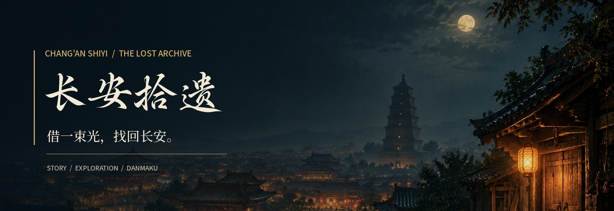
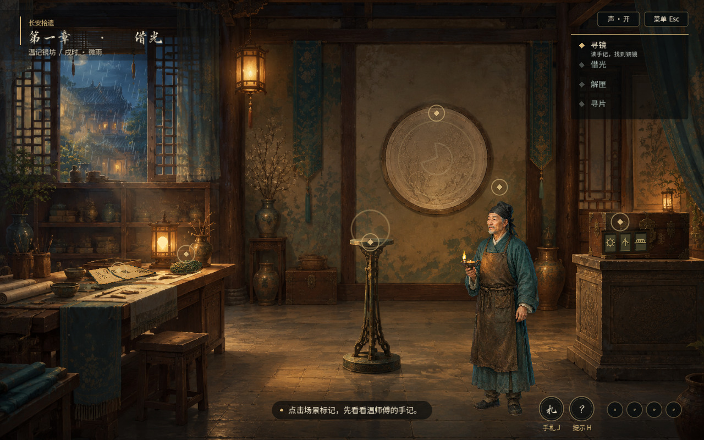
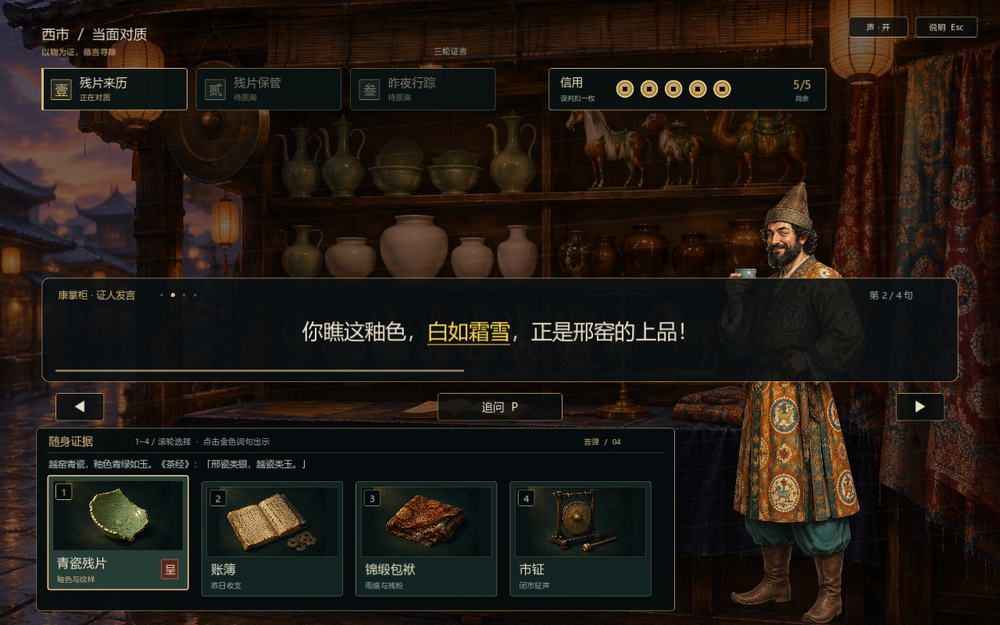
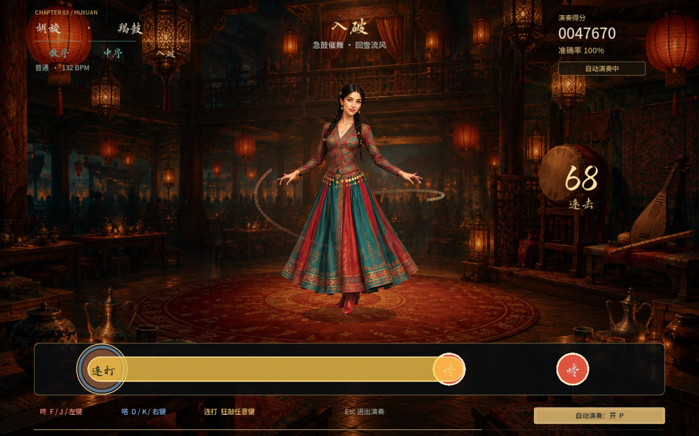
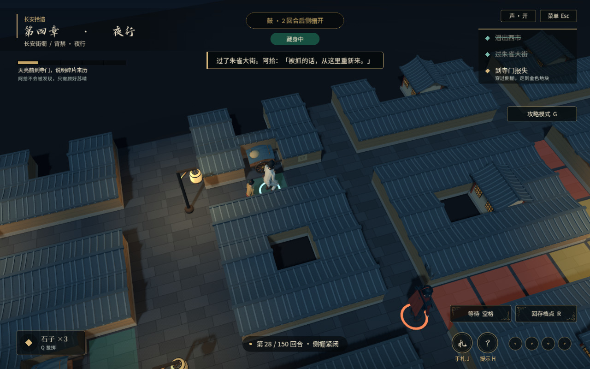
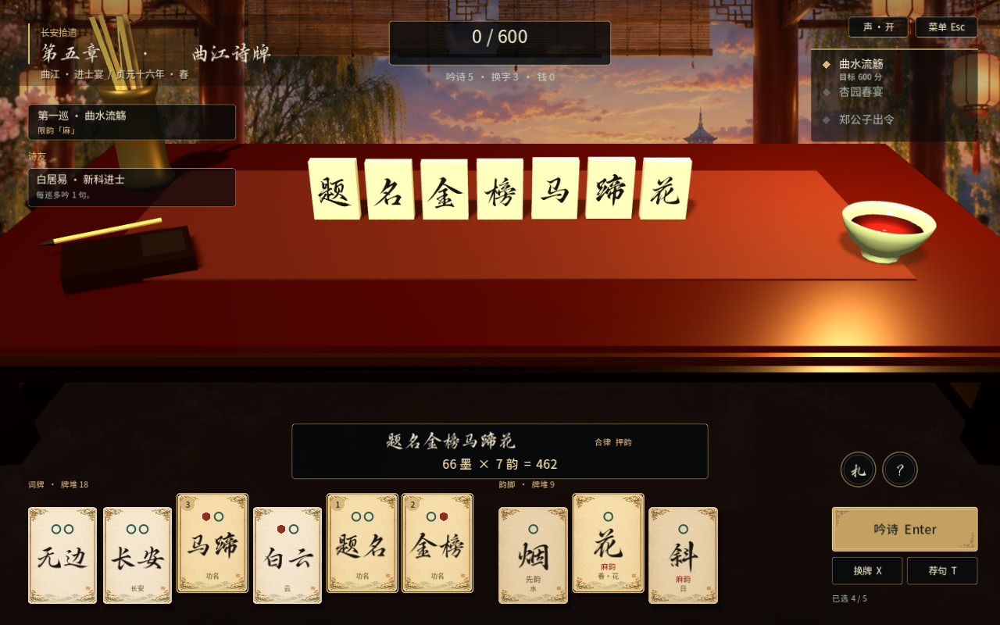
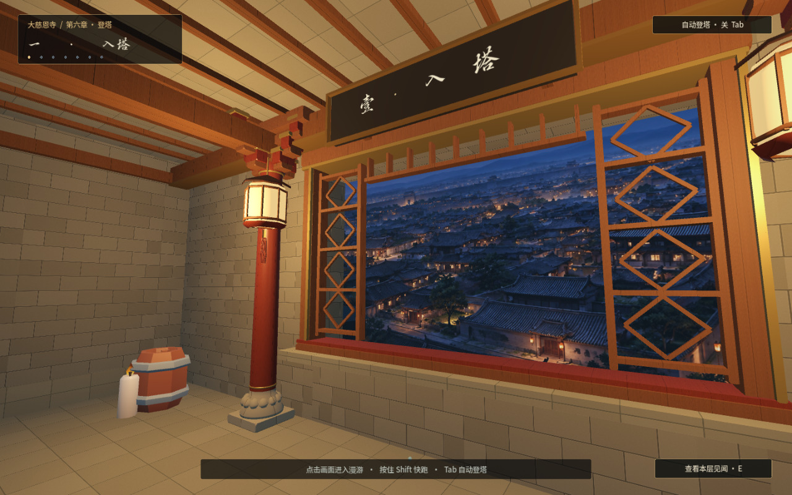
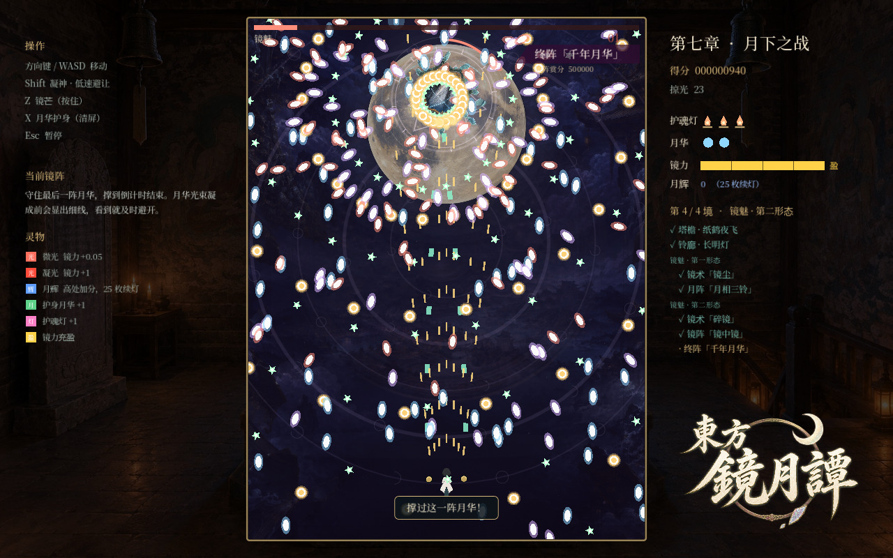
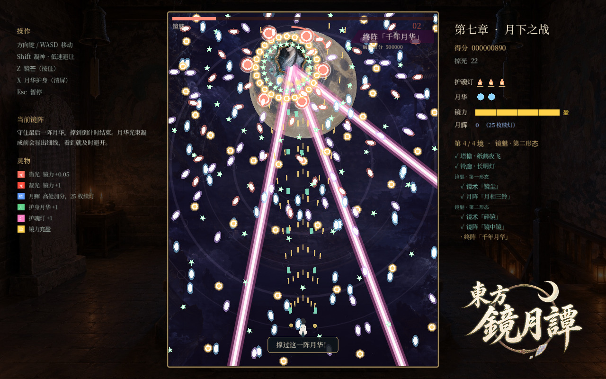

<div align="center">
  
  <br><br>
  <strong>一面铜镜，四片青瓷，一场穿过长安的寻瓷之旅。</strong>
  <br><br>
  
  
  
  
  <p>
    <a href="#实机画面">实机画面</a> ·
    <a href="#章节与玩法">章节与玩法</a> ·
    <a href="#快速开始">快速开始</a> ·
    <a href="#操作与体验">操作与体验</a> ·
    <a href="#开发与文档">开发与文档</a>
  </p>
</div>

---

**《长安拾遗 · 镜照工坊》** 是使用 Godot 4 制作的多章节国风剧情游戏，结合点击解谜、证据对质、节奏演奏、3D 潜行、诗牌构筑、第一人称探索与弹幕战斗。

数字修复师**苏晴**在扫描唐代铜镜时，被镜光带回了千年前的长安。为了找齐一只越窑莲纹碗的四片残片，她从温记镜坊出发，穿过西市与酒肆，避开宵禁巡夜，赴曲江诗宴，循镜中低语登上大雁塔。

> **以物证推进故事，以玩法体验风物。** 铜镜反光、胡旋鼓点、坊市夜禁、曲江诗宴与月相机关，分别成为旅途中的交互线索。

| 连贯的长安旅程               | 每章不同的玩法                 | 图像、声音与演出             |
|:--------------------- |:----------------------- |:-------------------- |
| 序章、七章主线、终章与尾声，沿舆图逐步解锁 | 从工坊机关到诗牌构筑，再到塔顶弹幕       | AI 场景与人物、角色配音、五段剧情视频 |
| 碎瓷、铜镜与人物对白串联前后线索      | 2D 绘制与 3D 场景结合，保留各章操作特色 | 书法字体、唐风装饰、灯火与镜光动画    |
| 通关后开放人物与文化图鉴          | 支持章节重访、对话回看和辅助体验        | 运行素材随工程提供，可离线游玩      |

## 实机画面

<table>
  <tr>
    <td width="50%"><br><b>温记镜坊 · 借光寻片</b><br><sub>调查手记、拖放铜镜，以一束光解开旧匣。</sub></td>
    <td width="50%"><br><b>西市对质 · 以物为证</b><br><sub>比对证言与物证，在交锋中识破矛盾。</sub></td>
  </tr>
  <tr>
    <td><br><b>胡姬酒肆 · 为舞击鼓</b><br><sub>散序、中序、入破，鼓点与胡旋舞逐步展开。</sub></td>
    <td><br><b>长安街衢 · 宵禁夜行</b><br><sub>观察巡逻、借暗处藏身，与阿拾穿过夜街。</sub></td>
  </tr>
  <tr>
    <td><br><b>曲江诗牌 · 选词成句</b><br><sub>组合词牌与韵脚，以平仄、押韵和诗友搭配过令。</sub></td>
    <td><br><b>大雁塔 · 循光登临</b><br><sub>第一人称穿过七层木阶，在镜光中接近谜底。</sub></td>
  </tr>
</table>

<p align="center">
  
  <br><b>塔顶月下 · 终阵「千年月华」</b>
  <br><sub>月雨、星环、六瓣花形与分裂弹交织；战斗中的机关线索来自此前的旅途。</sub>
</p>

<details>
<summary><b>再看一张：旋转光束与花瓣弹幕</b></summary>

<p align="center"></p>

</details>

截图来自游戏实际渲染。更多画面见 [实机截图目录](docs/screenshots/)。

## 章节与玩法

| 旅程        | 地点      | 主要交互                      |
|:--------- |:------- |:------------------------- |
| 序章 · 扫描异常 | 现代修复实验室 | 调查文物、完成扫描与校准，经镜光进入长安      |
| 第一章 · 借光  | 温记镜坊    | 拖放铜镜、转镜显纹、三纹锁解谜、开匣与手灯寻片   |
| 第二章 · 对质  | 西市      | 调查物件、选择证据、锁定证言矛盾，触发识破演出   |
| 第三章 · 胡旋  | 胡姬酒肆    | 酒肆调查、击鼓伴舞、连击判定与三段音乐演出     |
| 第四章 · 夜行  | 长安街衢    | 回合制 3D 潜行、巡逻视野、藏身、投石与路线规划 |
| 第五章 · 诗牌  | 曲江池     | 五言／七言组句、押韵与平仄计分、批量换牌、诗友构筑 |
| 第六章 · 登塔  | 大雁塔     | 第一人称七层探索、逐层对白、镜魅引路与剧情视频   |
| 第七章 · 月下  | 塔顶      | 纵向弹幕、射击与低速避让、月相三铃及镜阵辨真    |
| 终章 · 金缮   | 重返镜坊    | 拖拽、旋转并拼合四片青瓷，完成修复与告别      |
| 尾声 · 归来   | 现代修复实验室 | 3D 环境调查、镜中回忆，衔接通关与文化图鉴    |

通关尾声后，标题页开放 **「长安拾遗录」**：按人物、器物、风俗与长安四类浏览 **33 项**内容，附历史文化说明与出处，并区分历史人物和虚构角色。[查看图鉴内容与出处](docs/culture/长安拾遗录-内容与出处.md)

## 快速开始

### 下载直接运行（Windows）

前往 **[下载最新版 Windows 独立版](https://github.com/user-lqt/changan-shiyi/releases/latest)**，下载 `长安拾遗.exe` 后双击启动。适用于 Windows 10／11 64 位；无需安装 Godot、Steam 或其他开发工具，游戏素材已内嵌，可离线游玩。

当前发布版更新于 **2026-10-19**，已包含行旅设置、50% 默认音量、批量换牌、近期美术与音乐调整，以及五段 AI 剧情视频。[导出与校验记录](docs/releases/2026-10-19-windows.json)

### 打开工程

使用 **Godot 4.7.2 标准版**，无需 .NET 运行环境。

```powershell
git clone https://github.com/user-lqt/changan-shiyi.git
cd changan-shiyi
```

在 Godot 项目管理器中导入 `project.godot`，等待首次资源导入完成，按 **F5** 运行。主场景为 `scenes/main.tscn`，渲染器采用 **GL Compatibility**。

**Windows 快捷入口：** 双击 [启动游戏.bat](启动游戏.bat) 游玩，或双击 [打开工程.bat](打开工程.bat) 编辑。脚本会查找预设的 Steam 安装路径和 PATH 中的 `godot`／`godot4`；也可通过 `GODOT_PATH` 指定引擎：

```powershell
$env:GODOT_PATH = 'C:\Tools\Godot\Godot.exe'
.\启动游戏.bat
```

游戏所需图片、字体、模型、音乐、角色配音和五段剧情视频均已包含在 `assets/` 中。**游玩无需联网、API Key、Python 或 Blender。**

### 直接试玩某一章

| 入口                     | 内容                |
|:---------------------- |:----------------- |
| [试玩第一章.bat](试玩第一章.bat) | 工坊调查、铜镜机关与开匣演出    |
| [试玩第三章.bat](试玩第三章.bat) | 酒肆调查与胡旋击鼓，可开启自动演奏 |
| [试玩第四章.bat](试玩第四章.bat) | 3D 夜行潜行，支持攻略路线提示  |
| [试玩第五章.bat](试玩第五章.bat) | 曲江诗牌、批量换牌与诗友搭配    |
| [试玩第六章.bat](试玩第六章.bat) | 第一人称登塔，可切换自动登塔    |
| [试玩尾声.bat](试玩尾声.bat)   | 回到现代实验室，查看文物与镜中记忆 |

独立试玩使用临时进度，不覆盖正常主线存档；另有 [试玩序章.bat](试玩序章.bat) 可直接体验开篇。

### 导出 Windows 独立版

先在 Godot 中安装 **4.7.2 对应的导出模板**，然后运行：

```powershell
powershell -NoProfile -ExecutionPolicy Bypass -File .\tools\export_windows.ps1
```

引擎不在预设位置时，可给脚本传入 `-GodotPath 'C:\Tools\Godot\Godot.exe'`。导出结果为 `build/长安拾遗_Windows/长安拾遗.exe`，游戏资源内嵌，运行时无需安装 Godot。

GitHub 保存工程与运行素材；本机的 `build/` 成品、导入缓存、临时预览、原始 MP4 和重复交接包不纳入版本管理。

## 操作与体验

| 场景       | 操作                                                   |
|:-------- |:---------------------------------------------------- |
| 通用调查     | 鼠标点击热点、物品与选项；部分机关支持拖放与旋转                             |
| 对话       | `空格`／`Enter` 推进；`H` 查看历史并重听配音，已选分支可返回重选              |
| 手札与提示    | `J` 查看手札；非对话时 `H` 获取当前提示                             |
| 暂停与设置    | `Esc` 打开菜单；可重开本关、返回舆图／标题，调整音量、文字速度和全屏                |
| 第四章 · 潜行 | `WASD`／方向键移动，`空格` 等待，`Q` 投石，按住 `Tab` 看全图，`G` 路线提示    |
| 第五章 · 诗牌 | 点击选牌，`Enter` 吟诗，`X` 批量换牌                             |
| 第六章 · 登塔 | `WASD` 行走，`Shift` 快跑，鼠标观察，`E` 调查，`Tab` 自动登塔，`R` 返回本层 |
| 第七章 · 弹幕 | `WASD`／方向键移动，`Shift` 低速避让，按住 `Z` 发射镜芒，`X` 月华护身       |
| 显示       | `F11` 切换全屏                                           |

人物语音、BGM、环境音效可分别调节，默认音量均为 **50%**。第三章支持自动演奏并计入通关，第六章支持自动登塔；五段 AI 剧情视频均可跳过。

<details>
<summary><b>课堂演示、存档与快速体验</b></summary>

- 在舆图按 **F9** 解锁各章，便于切换展示。
- 在关卡内依次输入 **S K I P** 可直接通关，相邻字母间隔不超过 1.5 秒。
- 暂停菜单的「重新开始本关」恢复进入本章时的进度；已完成章节可从舆图重访。
- 主线存档为 `user://changan_save.json`，设置独立保存在 `user://changan_settings.cfg`，由 Godot 写入用户数据目录。

</details>

## 多模态制作

| 内容       | 制作与接入                                               |
|:-------- |:--------------------------------------------------- |
| 场景、人物与装饰 | 使用 **GPT-image-2** 生成图像，经过抠图、分层、裁切和色彩处理，接入游戏交互与动画   |
| 角色声音     | 使用火山引擎语音合成生成角色台词，按说话人与文本关联资源；镜魅增加叠声与回响处理            |
| 剧情视频     | 五段 AI 视频分别衔接序章穿越、登塔回声、镜光凝形、实验室归来与镜中长安               |
| 三维空间与角色  | **Blender + Godot** 制作模型、场景和关节动作，GLB 用于夜街、诗案、登塔及实验室 |
| 游戏逻辑与演出  | **GDScript** 实现玩法、对白、存档、镜头、光效、弹幕和各类中间动画             |
| 音乐与音效    | 包含程序合成的环境乐、胡旋谱曲及机关音效，以及标注来源的外部音乐                    |

资源生成与处理脚本位于 `tools/`。需要重新生成素材时，再准备相应的本地工具或接口配置；已有成品素材可直接用于运行。

## 开发与文档

```text
changan-shiyi/
├── project.godot             Godot 工程入口
├── scenes/                  主场景
├── scripts/
│   ├── main.gd              场景切换、进度、音频与设置
│   ├── chapters/            标题、舆图与各章玩法
│   ├── core/                对话、绘制、3D 环境、规则与验证
│   ├── data/                剧情、诗牌、节奏谱面与图鉴
│   └── shaders/             镜光、衣料、水面与其他视觉效果
├── assets/                  游戏运行素材
├── art/                     部分美术原稿与 Blender 源文件
├── tools/                   启动、导出、建模与素材处理
└── docs/                    玩法、美术、剧情与实机记录
```

| 想了解什么      | 文档                                                                                                                  |
|:---------- |:------------------------------------------------------------------------------------------------------------------- |
| 工程目录与本地材料  | [工作区导航](工作区导航.md) · [文档索引](docs/README.md)                                                                          |
| 最新功能与美术更新  | [2026-10-19 更新记录](docs/art/oct19-refresh.md)                                                                        |
| 诗牌规则与文化依据  | [第五章 · 曲江诗牌](docs/gameplay/第五章-曲江诗牌.md)                                                                             |
| 夜行人物、场景与动作 | [第四章美术说明](docs/art/ch4-night.md)                                                                                    |
| 七层登塔与镜魅引路  | [第六章美术说明](docs/art/ch6-tower.md)                                                                                    |
| 图鉴资料与历史出处  | [长安拾遗录](docs/culture/长安拾遗录-内容与出处.md)                                                                                |
| AI 资源制作过程  | [制作记录](docs/ai-records/资源制作记录.md) · [近期素材更新](docs/art/oct19-refresh.md)                                             |
| 视频触发与接入    | [序章](assets/videos/prologue/README.md) · [登塔](assets/videos/ch6/README.md) · [尾声](assets/videos/epilogue/README.md) |

<details>
<summary><b>运行逻辑与界面检查</b></summary>

在工程目录中执行，使用实际 Godot 可执行文件替换 `godot`：

```powershell
godot --headless --path . -- --self-test
godot --path . -- --ui-test
godot --path . -- --ui-test-navigation
```

分别覆盖关卡逻辑、真实视口交互和导航／设置。检查模式使用临时进度；界面检查需要图形环境。更多说明见 [验证入口](tests/README.md)。

</details>

---

**素材致谢**：Godot Engine；Kay Lousberg 的 [KayKit](https://kaylousberg.com/) 模型（[CC0 许可](assets/models/tower_kaykit/LICENSE.txt)）；Noto 字体（[Sans](assets/fonts/notosanssc-OFL.txt)、[Serif](assets/fonts/notoserifsc-OFL.txt)）；演示流云楷书法字体。各素材权利归相应作者所有。
