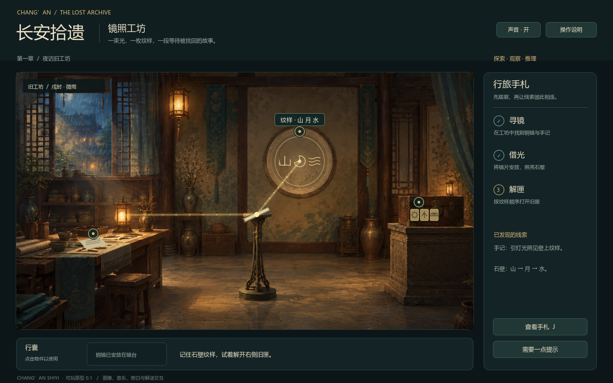

# 长安拾遗 · 镜照工坊

## 当前工程快照

本仓库保存 2026 年 10 月 19 日的完整可运行工程，包括序章、七章主线、终幕与尾声，以及对应的图片、模型、音乐、配音和五段已接入 AI 视频。使用 **Godot 4.7.2** 打开 `project.godot`，等待首次资源导入完成后按 **F5** 运行；游戏运行无需联网或配置 API Key。

```powershell
git clone https://github.com/user-lqt/changan-shiyi.git
```

仓库包含源码、运行素材、美术原稿、工具与开发文档。本机缓存、临时预览、原始 MP4 交付件、重复交接包和已有 EXE 保留在本地；游戏使用的视频已经包含在 `assets/videos/`。导出独立运行版请使用 `tools/export_windows.ps1`，需先在 Godot 中安装匹配版本的导出模板。下方保留早期介绍与开发记录，当前功能以本节和 [近期更新](docs/art/oct19-refresh.md) 为准。

双击 [启动游戏.bat](启动游戏.bat) 运行当前工程，或使用 [打开工程.bat](打开工程.bat) 进入编辑器。文件位置、现有 EXE、视频交接材料及文档分类见 [工作区导航](工作区导航.md)。

> **第六章「登塔」已重做为第一人称 3D。** 双击 `试玩第六章.bat`；WASD 行走、按住 Shift 快跑、鼠标观察、E 查看见闻、Tab 自动登塔、R 返回本层平台、Esc 释放鼠标。七层演出衔接塔顶战斗，第四层与第七层已接入 1080p AI 视频。[视频说明](assets/videos/ch6/README.md)。

第六章现已加入斗拱、莲瓣柱础、花格窗、纸灯笼与精细木阶；镜魅保持悬浮铜镜形态，镜内人影随登塔逐渐显露，并在演出后沿楼梯飞升，引导玩家前往上一层。月相三铃使用 AI 月面贴图，窗外为专用长安街坊夜景。[美术与素材记录](docs/art/ch6-tower.md)。

> **第五章「曲江诗牌」可试玩。** 双击 `试玩第五章.bat`，体验选词组句、平仄押韵与诗牌构筑。独立试玩不修改主线存档。[玩法说明](docs/gameplay/第五章-曲江诗牌.md)。当前工程已扩展为多章与局部 3D，下方单房间介绍为早期版本记录。

一个使用 **Godot 4** 制作的 2D 点击解谜小样。你将在夜间的旧工坊里寻找铜镜，将灯光引向石壁，再根据显现的纹样解开旧匣，取回青瓷残片。



## 开始试玩

双击 **`启动游戏.bat`**，在标题页选择「进入工坊」。本机已安装的 Steam 版 Godot 会直接运行游戏；游戏过程中无需联网或调用 API。

双击 **`试玩第一章.bat`**，可直接体验温记镜坊：拖放铜镜、借光显纹、三纹锁转动、卡扣退开与开匣、碎片拾取，以及风吹灯灭后的手灯寻片。独立试玩不修改主线存档。关键演出开始后，空格或 Enter 可跳过。

双击 **`试玩第三章.bat`**，可体验酒肆调查与胡旋击鼓：米娜八张舞姿、散序／中序／入破三段演出、书法标题与音符。准备页可开启自动演奏，演出中按 **P** 切换；自动演奏同样可以过关。[演出与操作说明](docs/art/ch3-huxuan.md)。

双击 **`打开工程.bat`**，可在 Godot 编辑器中查看、修改场景与脚本。主场景为 `scenes/main.tscn`，按 F6 运行当前场景，或按 F5 运行整个项目。

启动脚本自动查找本机 Steam 安装位置，也支持通过环境变量 `GODOT_PATH` 指定 Godot 4 可执行文件。

Windows 独立运行版位于 `build/长安拾遗_Windows/长安拾遗.exe`，双击即可离线游玩，无需安装 Godot。重新导出可执行 `tools/export_windows.ps1`。

暂停菜单新增「重新开始本关」，恢复本次进入关卡时的进度并重置关内玩法。关卡内依次输入 **S K I P**（相邻字母间隔不超过 1.5 秒）可直接通关并补齐本关奖励与剧情标记；标题和舆图中不会触发。舆图界面按 **F9** 可解锁各章。

标题页或暂停菜单中的 **「行旅设置」** 可分别调节人物语音、背景音乐、环境音效，以及文字速度与全屏显示；调整自动保存在本机，F11 也可切换全屏。第五章从舆图重访时会重新开始诗牌挑战，保留已获得的通关解锁。2026-10-19 美术、语音及 Boss 开场音乐更新见 [更新记录](docs/art/oct19-refresh.md)。

## 操作

| 操作 | 用途 |
| --- | --- |
| 鼠标点击场景中的金色圆点 | 调查手记、拾取道具、使用镜台、打开旧匣 |
| 按住桌边或行囊中的铜镜拖动 | 拖到镜台松手安放；放偏会返回，Esc 取消拖动 |
| 点击下方行囊中的铜镜 | 也可点选后，再点击镜台安放 |
| A / D、左右方向键、滚轮或画面按钮 | 安放后转动铜镜 |
| 点击旧匣内的纹样卡片 / 数字键 1 2 3 | 切换纹样，下方按钮可向前切换 |
| J | 查看已经发现的线索 |
| H | 对话中查看历史，当前对话的已选选项可返回重选；其他时候获取当前阶段提示 |
| Enter / 空格 | 标题页开始游戏；面板中确认；关键演出开始后跳过 |
| Esc | 关闭面板；没有面板时打开操作说明 |
| 右上角声音按钮 | 开关音乐、音效与旁白 |

探索进度自动保存在本机 Godot 用户数据目录中的 `workshop_save.json`。重新打开游戏可以继续；标题页的「重新开始」会重置本章进度。

## 体验内容

- **寻找线索**：阅读工匠手记，拾取可使用的铜镜。
- **操作机关**：把镜片安放在镜台上，调整反射光线方向。
- **图形推理**：石壁显现三枚纹样，结合顺序开启三纹锁。
- **完成收集**：旧匣开启后，再点击取回青瓷残片。
- **文物图鉴**：拾得铜镜、取回残片时弹出 AI 绘制的文物特写与文化介绍（海兽葡萄纹铜镜、越窑青瓷）。
- **多模态反馈**：AI 场景图与标题插画、实时光束与光粒、窗外雨丝、灯笼呼吸光、古筝风格环境音乐、雨声、11 种交互音效与中文旁白。

### v0.2 打磨内容

- 美术：新增 4 张 gpt-image-2 素材（标题页雨夜长安、铜镜、青瓷残片、手记纸张），面板加入唐式角花，手记盖「匠」字朱印。
- 动效：进入工坊淡入；面板弹出缩放；手记文字逐行浮现；铜镜转动平滑插值；光束接近圆盘时圆盘渐亮；石壁纹样依次显现；旧匣开盖动画与残片浮起；纹样卡片翻转；答错时面板抖动；点击涟漪。
- 声音：音乐重制为 D 宫调五声音阶古筝风格并无缝循环；雨声独立分轨；新增悬停、安放、拨纹样音效。
- 交互：铜镜可拾取后先看图鉴；悬停热点有轻提示音；结算显示本章用时与提示次数；新增数字键与 Enter 快捷操作。

这是约 3–5 分钟的单房间原型，用于体验核心互动逻辑。

<details>
<summary>卡住时查看通关步骤</summary>

1. 点击左侧工作台上的手记，读完后关闭。
2. 按住桌边的小铜镜，拖到画面中央的空镜台后松手；也可先拾取后从行囊拖动。
3. 铜镜落座后开始引光。
4. 从初始角度向右转动四次，光束将照亮右上方石壁圆盘。
5. 点击右侧旧匣，将纹样从左到右调整为「山、月、水」。
6. 点击「尝试开启」，观看卡扣退开与匣盖抬起，回到场景后点击旧匣取出残片。
7. 风吹灯灭后，移动手灯，沿火苗偏向寻找第二片碎瓷。

</details>

## 工程与资源

```text
project.godot              Godot 工程入口
scenes/main.tscn           主场景
scripts/main.gd            绘制、机关、交互、存档与验证
assets/images/            场景背景、标题插画、文物特写与图标
assets/audio/             环境音乐、雨声、11 个音效、3 段中文旁白
assets/fonts/             本机中文字体
tools/                    启动与声音生成脚本
docs/ai-records/           图像提示词及资源生成记录
docs/screenshots/         实机截图
```

场景背景、标题插画、铜镜、青瓷残片和纸张底纹使用 **GPT-image-2** 生成。环境音乐与音效由程序原创合成，中文旁白由 Windows 本地语音引擎生成，资源来源与制作方法见 [资源制作记录](docs/ai-records/资源制作记录.md)。游戏目录不包含 API 密钥。

## 验证

验证覆盖各章游戏状态与真实视口鼠标操作；第一章包含拖放成功与返回、安放与开盖期间防误触、灯灭过渡和碎片收集。

使用 Godot 命令行重跑：

```text
godot --headless --path . -- --self-test
godot --path . -- --ui-test
```

`--ui-test` 使用真实渲染与视口鼠标事件；两种验证模式都不会修改正常玩家的存档。
