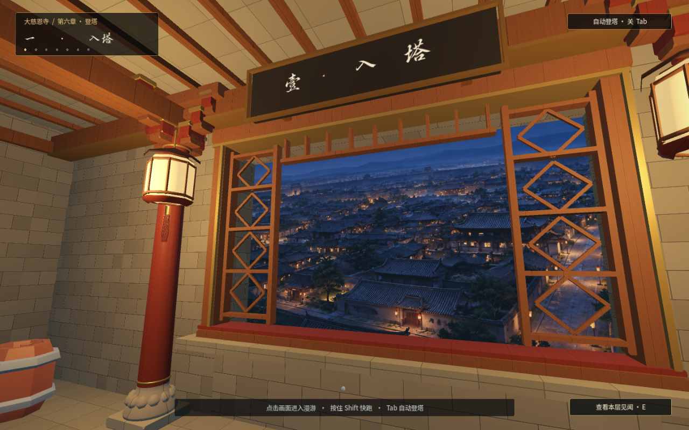
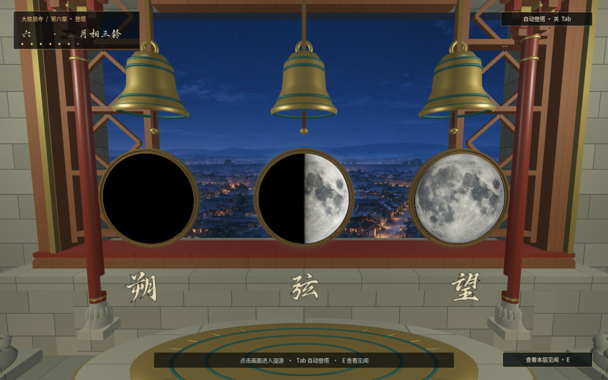

# 第六章 · 登塔美术

双击工程根目录的 `试玩第六章.bat`，可直接进入第一人称登塔。WASD 行走，按住 Shift 快跑，Tab 自动登塔；第四层「镜中回声」与第七层「镜光凝形」已接入 AI 视频。

## 塔内模型

新增 11 个原创 GLB 模型：斗拱柱、菱格栏杆、花格窗、纸灯笼、木阶、铜镜架、铜铃、莲台、残镜核心、悬浮镜片与藻井。

木构增加倒角、榫接和包边，柱础带莲瓣，灯笼带骨架与流苏。砖、木、石材使用细节纹理及法线贴图。楼梯外观与行走碰撞分离，保证上楼平顺。

六处楼梯转角的内侧栏杆仅覆盖中央临空段，两个梯口保留完整开口；牌匾、边框和文字作为一组前置于横梁，避免遮住书法笔画。

- 模型：`assets/models/tower_tang/`
- 可复现生成源：`tools/build_tower_models.py`
- 材质生成源：`tools/build_tower_textures.py`

镜魅以八瓣铜镜为主体，增加多层铜边、云纹、铜扣和细裂纹，破镜片与细光带绕镜缓慢转动。第三层突然凝聚，镜内人影随楼层逐渐清晰；沿用最终战的形象，只呈现下半脸与衣襟，遮住双眼。第六层的镜魅偏置于三铃旁，保留月相和文字的视野。

每层沿用原有对话、见闻和演出：镜魅出现 → 玩家阅读或观看 → 镜片收拢、拖出光迹 → 沿现有楼梯通道飞向上一层 → 在上层等待。第四层影片结束后再起飞，第七层停留并衔接最终战。人物行走碰撞与通行路线保持原有设置。

人影素材由 `tools/prepare_tower_reflection.py` 从现有最终战立绘制作，输出至 `assets/images/tower/spirit_reflection.png`；镜面通过不透明着色器逐层显影。全塔使用一个移动的镜魅模型。

## AI 贴图

生成方式：imagegen 技能的 CLI 接口模式，模型 **GPT-image-2**，使用已有的本机接口配置。运行游戏无需联网。

| 素材 | 游戏内文件 | 用途 |
| --- | --- | --- |
| 月面 | `assets/images/tower/moon_face_ai.png` | 月海、陨石坑、撞击射纹；同一张贴图结合球面光照，表现朔、弦、望 |
| 长安街坊夜景 | `assets/images/tower/changan_rooftops_ai.jpg` | 塔内俯瞰低矮街坊、屋顶与街巷，替换含塔形建筑的旧背景 |

完整生成提示词与 AI 原图保存在 `output/imagegen/ch6/`，其中 `prompts.jsonl` 是本次使用的完整提示词集；不包含接口凭据。

月面提示词核心：正面完整月球、月海与陨石坑细节、均匀光照、圆面居中、黑底，便于游戏内重建月相。

夜景提示词核心：从塔内俯瞰唐代长安，低矮坊巷和院落、暖色灯火、蓝灰夜空，画面中不出现其他塔楼。

`tools/prepare_tower_art.py` 负责规范月面圆盘尺寸及导出游戏使用的图片，保留原图。

## 实机检查

191 项主线流程检查通过，包含七层实际碰撞路线、自动登塔、两段演出及第七章衔接。另有 27 项对话与镜魅专项检查，覆盖选择回退、回调只执行一次、显影递进、向上飞行、上层等待、暂停与两段实播视频。月相、文字和镜魅外观经实机截图确认。

