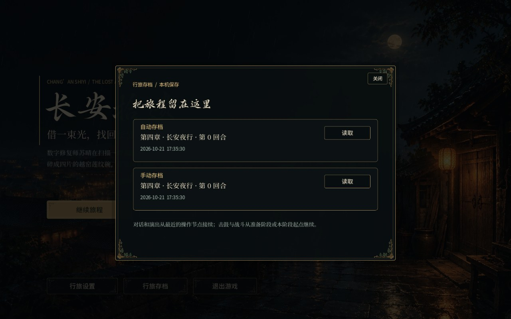
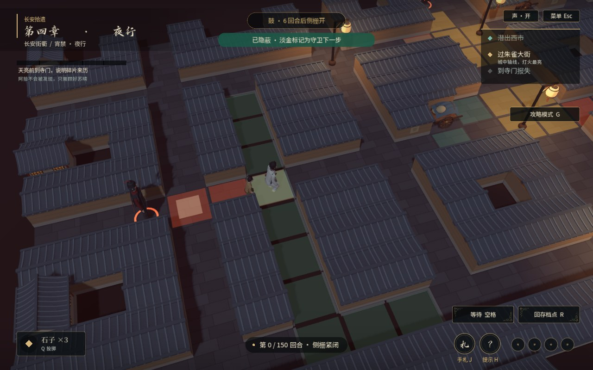
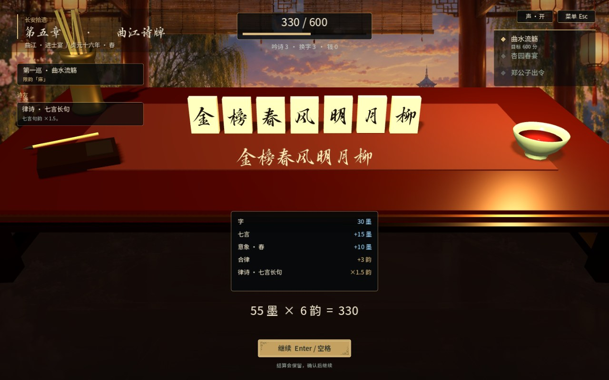
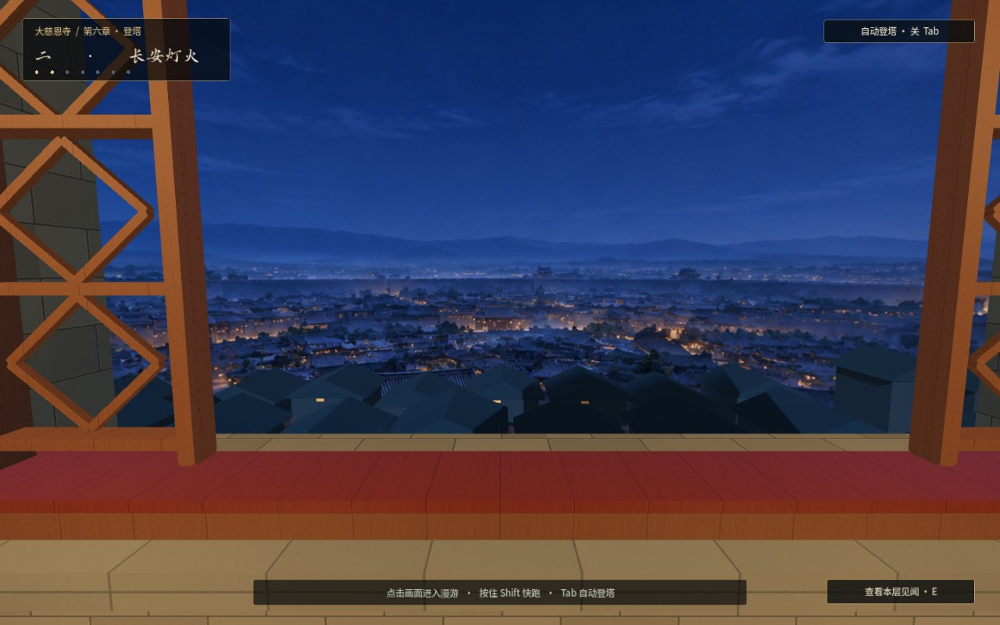

# 2026-10-21 试玩反馈优化

- 标题页加入“退出游戏”和“行旅存档”；重新开始旅程需确认，手动存档予以保留。
- 第四章加入 Z 撤回，可连续回退移动、等待和投石；守卫、回合、栅门、石子及相关状态同步恢复。被发现后可选择撤回或回检查点；跨过中途检查点后开启新的撤回历史。
- 绿色藏身点增加明确提示、轻微呼吸光和附近守卫下一步位置预告；在过街、接近侧栅的位置补充藏身点。
- 增加关卡续玩：一个自动存档、一个手动存档；标题页与暂停菜单均可读取，关卡暂停菜单可手动保存。第五章保存手牌、抽牌堆、选择及随机数状态；第四章同时保存撤回历史。
- 对话和演出从最近的可操作节点恢复，第三章演奏从准备阶段恢复，第七章战斗从当前阶段起点恢复并暂停。登塔保留楼层、位置和已完成的剧情；尾声保留观察进度与位置。
- 存档继续使用本机用户数据目录，支持旧版章节进度。写入采用临时文件替换并保留备份，主文件受损时尝试备份。
- 第五章逐句结算完整展示后等待确认；第一次提前确认仅加速展示，下一次确认继续，包括最后一句。
- 第六章远景改为天空背景，与有视差的近处屋顶、窗框共同形成层次，消除有限远景平面的边缘。
- 第一章三纹锁初始状态统一为“云—云—云”，解谜答案保持“山—月—水”。

运行 `--self-test` 检查全流程逻辑；`--self-test-playtest` 可快速检查本轮交互与存档改动。实际渲染截图见 `docs/screenshots/oct21-playtest/`。

## 配音更新

20:35 重新导出 Windows 独立版，替换第三章米娜的两句台词配音，加入西域口音。下载版本为 `snapshot-2026-10-21-r2`。

## 验证结果

- Windows 独立 EXE：全流程逻辑与存档检查 220 项通过。
- 实际视口导航：菜单、重玩、设置和战斗存档入口 53 项通过。
- 使用导出的 EXE 检查存档菜单、结算停留和塔外夜景。

## 实机画面

### 行旅存档

### 夜行藏身与守卫预判

### 诗牌结算等待确认

### 塔外长安夜景

